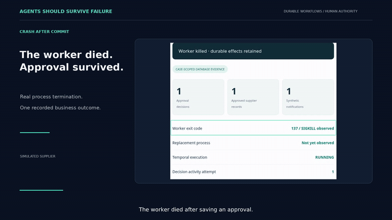
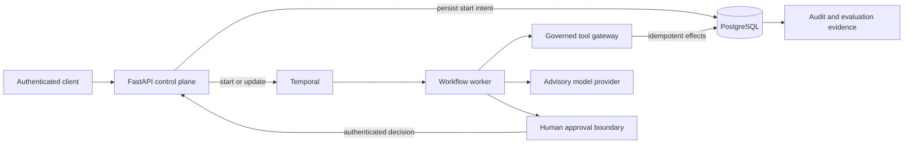

# Agents Should Survive Failure

**A supplier approval survives a worker crash without creating a second approval, supplier record, or notification.**

[](https://github.com/kabbersokhi-boop/agents-should-survive-failure/actions/workflows/ci.yml)
[](https://github.com/kabbersokhi-boop/agents-should-survive-failure/releases/latest)
[](pyproject.toml)
[](LICENSE)

> Activities can retry. The recorded business outcome remains one.

## See the failure and recovery

[](https://raw.githubusercontent.com/kabbersokhi-boop/agents-should-survive-failure/main/docs/evidence/portfolio/demo/overview.mp4)

**[Watch the project in action — 1:33](https://raw.githubusercontent.com/kabbersokhi-boop/agents-should-survive-failure/main/docs/evidence/portfolio/demo/overview.mp4)**

A human approves one supplier. The worker saves the records, then dies before acknowledging completion. A replacement worker resumes the same workflow, and the records remain one of each.

| What changes | What stays intact |
| --- | --- |
| Worker process is killed and replaced | The approved supplier case |
| Decision activity reaches attempt 2 | One approval, one supplier record, one notification |
| Temporal moves from running to completed | The original human decision |

[Subtitles](docs/evidence/portfolio/demo/overview.en.srt) · [Transcript](docs/evidence/portfolio/demo/overview-transcript.txt) · [Detailed walkthrough — 2:57](docs/portfolio-demo.md)

The demonstration uses a fictional supplier, real Temporal and PostgreSQL, deterministic model advice, and a locally stored notification. It does not send email. The crash is observed by a local test harness; database counts and native Temporal history establish the selected case's recovery.

## Why this matters

A process can fail after saving a business decision but before reporting success. Retrying blindly can repeat the action. Abandoning the workflow can leave approved work unfinished.

This project separates **human authority**, **durable coordination**, and **committed business records**. Model advice informs the review; an authenticated operator decides. Recovery resumes the work while preserving that decision.

## Try it locally

Requirements: Docker with Docker Compose, Python 3.12, [uv](https://docs.astral.sh/uv/), GNU Make, and Bash. The commands below use GNU Make, the local task runner defined in the [Makefile](Makefile). No paid model account or external API key is required for the default demonstration.

```bash
git clone https://github.com/kabbersokhi-boop/agents-should-survive-failure.git
cd agents-should-survive-failure
make setup
make operator-demo-up
make operator-demo-session
```

Open **<http://127.0.0.1:18100/console/>**. Open the generated `artifacts/operator-session.json`, copy its `api_key` value, and paste it into the console's connection field. The generated session expires after four hours; run `make operator-demo-session` again to create another.

### Follow one supplier

1. Enter a fictional supplier, a unique reference, and an `example.invalid` email address. Start onboarding and select the case.
2. Inspect the policy evidence and pending approval. All three business-record counts should be **0**.
3. To reproduce the crash, copy the case UUID. In a second terminal, run the commands below, replacing `YOUR_CASE_UUID` with that UUID. Leave the recovery command running while you return to the browser.

```bash
make operator-demo-arm RUN_ID=YOUR_CASE_UUID
make operator-demo-recover RUN_ID=YOUR_CASE_UUID
```

4. Enter a decision rationale in the console and approve the supplier.
5. The harness kills the worker after the records are saved, then starts a replacement. Wait for Temporal to show **COMPLETED**, activity attempt **2 or greater**, and counts of **1 approval / 1 supplier / 1 notification**.

The [interactive guide](docs/operator-demo.md) explains each step and the recovery evidence. To approve a case without injecting a crash, skip step 3.

| Interface | Address |
| --- | --- |
| Supplier console | <http://127.0.0.1:18100/console/> |
| API documentation | <http://127.0.0.1:18100/docs> |
| Temporal history | <http://127.0.0.1:18088> |
| Grafana | <http://127.0.0.1:13000> |

Stop this demo while preserving its cases:

```bash
COMPOSE_PROJECT_NAME=agents-portfolio docker compose stop
```

For API development, default service ports, and database administration, use the [development runbook](docs/runbooks/local-development.md).

## Reproduce the crash automatically

After `make setup`, this command creates an isolated test environment, runs the approval and crash sequence, checks the recovered records, and removes that test environment:

```bash
make demo
```

Expected result:

```text
Worker crash proof passed: run=<uuid> decisions=1 projections=1 emails=1
retry=temporal-redelivery
```

`emails=1` counts a synthetic database notification, not a delivered message. The proof uses the standard local service ports; [port overrides](docs/runbooks/local-development.md#running-the-proof-alongside-other-local-services) let it run alongside other applications.

## Engineering guarantees

| Guarantee | Mechanism | Executable evidence |
| --- | --- | --- |
| Durable execution | Temporal history, retries, updates, and replacement workers | [Crash proof](scripts/worker_crash_proof.py) |
| Duplicate-safe effects | Stable keys, SQL transactions, and unique constraints | [Integration tests](tests/integration/test_vendor_onboarding_workflow.py) |
| Recoverable starts | Persisted start intent and stable workflow identity | [Start coordinator](src/agents_should_survive_failure/workflow_starts.py) |
| Human authority | Scoped keys, versioned requests, and idempotent decisions | [Approval tests](tests/unit/test_approval_updates_api.py) |
| Governed tools | Run-scoped grants, pinned versions, schema validation, and audit | [Tool gateway](src/agents_should_survive_failure/tool_gateway.py) |
| Bounded model role | Deterministic risk policy; advisory model explanations | [Model evidence service](src/agents_should_survive_failure/model_evidence.py) |

## Architecture



Authority stays separated by design:

1. Temporal owns durable coordination and redelivery.
2. PostgreSQL owns business truth, audit records, and idempotency constraints.
3. Deterministic policy owns risk calculation and authorization boundaries.
4. The model explains bounded evidence; it does not grant authority.
5. An authenticated human or service approves consequential decisions.

The same contracts support vendor onboarding and high-value refunds. Vendor onboarding is the
release-backed reference workflow. The refund workflow demonstrates reuse of the engine contracts
and remains a preview until its evaluation evidence is part of a release.

## Verify the system

```bash
make test test-security
```

With Node.js 22 installed, check the console presentation and recorded evidence:

```bash
make check-console
```

For the complete integration and evaluation suite:

```bash
make test-integration
```

The integration gate uses a separate Compose project. It checks migrations, service integrations, the reviewed evaluation cases, real crash recovery, and the separately packaged reference agent. `make verify` runs the full release gate, including lint, type checks, dependency checks, and packaging.

The [v0.2.0 evidence index](docs/evidence/v0.2.0.md) identifies the release commit, successful CI run, evaluation reports, and software bills of materials.

## Code tour

| Area | Start here |
| --- | --- |
| Durable workflows | [`workflows/vendor_onboarding.py`](src/agents_should_survive_failure/workflows/vendor_onboarding.py), [`workflows/refund/`](src/agents_should_survive_failure/workflows/refund/) |
| Workflow starts | [`workflow_starts.py`](src/agents_should_survive_failure/workflow_starts.py) |
| Governed tools and MCP | [`tool_gateway.py`](src/agents_should_survive_failure/tool_gateway.py), [`mcp_adapter.py`](src/agents_should_survive_failure/mcp_adapter.py) |
| Persistence | [`persistence/models.py`](src/agents_should_survive_failure/persistence/models.py), [`migrations/`](migrations/) |
| Evaluation | [`evaluation_scenarios.py`](src/agents_should_survive_failure/evaluation_scenarios.py), [`evaluation.py`](src/agents_should_survive_failure/evaluation.py) |
| Security | [`docs/threat-model.md`](docs/threat-model.md), [`tests/security/`](tests/security/) |
| External contract | [`packages/agents-should-survive-failure-sdk/`](packages/agents-should-survive-failure-sdk/), [`packages/reference-operations-agent/`](packages/reference-operations-agent/) |
| Observability | [`metrics.py`](src/agents_should_survive_failure/metrics.py), [`deployment/`](deployment/) |

Thirteen [architecture decision records](docs/adr/) explain the main ownership and reliability
trade-offs.

## Scope

This repository is a production-style reference implementation, not a hosted service or a claim
of production readiness. It does not provide multi-tenancy, high availability, enterprise
identity, Kubernetes operation, billing, or hostile-code isolation. External agent packages are
trusted, operator-installed code.

Read the [limitations](docs/limitations.md), [failure cases](docs/failure-cases.md), and
[threat model](docs/threat-model.md) before adapting the design.

## Documentation

- [Technical walkthrough](docs/technical-walkthrough.md)
- [System overview](docs/system-overview.md)
- [Evaluation methodology](docs/evaluation-methodology.md)
- [Tool and agent trust model](docs/security/tool-and-agent-trust.md)
- [Architecture decisions](docs/adr/)

Licensed under the [Apache License 2.0](LICENSE).
